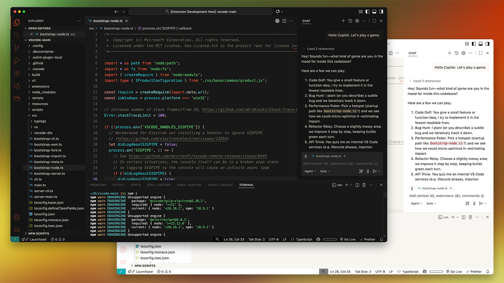
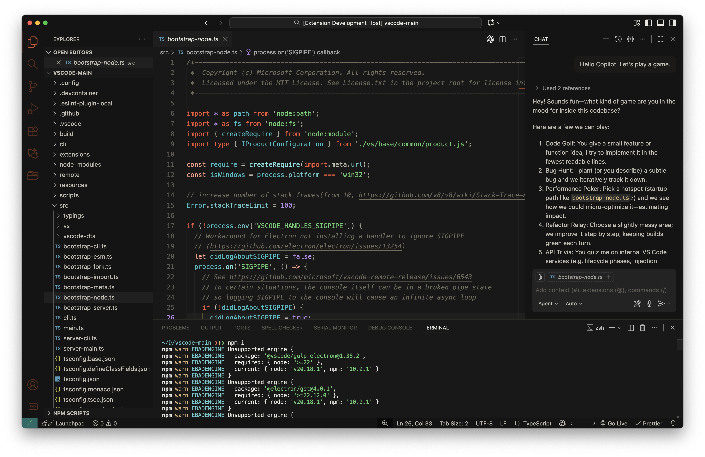
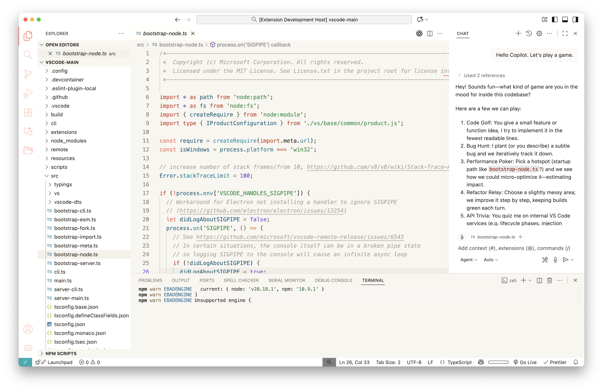

# Hydra Pressure for VSCode

**Hydra Pressure** wraps VS Code in candy-neon ember orange and chilled cyan, pairing industrial edges with playful highlights; the name comes from the [_Torrentz Hydra Splatling_](https://splatoonwiki.org/wiki/Torrentz_Hydra_Splatling) heavy weapon in Splatoon 3, which inspired the palette.

## Key Features

- **Semantic-first tokens** – uses VS Code semantic colors so variables, types,
  and hints stay distinct in TypeScript, Go, and friends.
- **Language-consistent palette** – tuned across common languages so comments,
  constants, and operators read the same in JS, Markdown, JSON, etc.
- **Diff & diagnostics pop** – dedicated hues for git diff, inline errors, and
  hints so status colors never clash with the main UI.
- **Layered contrast** – subtle gradient backgrounds and selection fills keep
  long sessions readable without flattening everything into one shade.
- **Terminal/UI harmony** – ANSI colors plus GitLens/Testing panel accents
  borrow from the same palette, so tools outside the editor feel native.

## Changelog

See [CHANGELOG.md](./CHANGELOG.md) for release notes.

## License & Credits

- Code & theme files: [MIT](./LICENSE)

